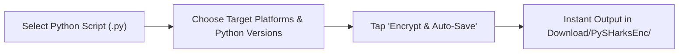

# 🦈 PySHarksEnc Mobile

> **The Standalone Native Python Compiler & Encryptor for Android**  
> *Transform your Python scripts into hardened native executables directly on your phone.*

[](https://github.com/SpokyCqp/PySHarksEnc)
[](https://github.com/SpokyCqp/PySHarksEnc)
[](https://github.com/SpokyCqp/PySHarksEnc)
[](https://github.com/SpokyCqp/PySHarksEnc)
[](https://github.com/SpokyCqp/PySHarksEnc/releases)

---

## 🌟 What is PySHarksEnc?

**PySHarksEnc** is a high-performance Android application designed to compile, protect, and encrypt Python scripts into native cross-platform binaries directly on your smartphone. 

With PySHarksEnc, you don't need a PC, a cloud server, or an internet connection. The app embeds a full offline C-compiler engine and Python runtime, allowing you to produce standalone, protected Python payloads for **Android**, **Linux**, and **Windows** anywhere, anytime.

---

## ✨ Key Highlights

- **📱 100% Offline & Mobile-First**: Everything happens locally on your Android device. Zero code leaves your phone.
- **⚡ Native Cross-Compilation**: Compiles Python source code into native machine code (ELF executables and Windows PE binaries) using on-device toolchains.
- **🎯 Multi-Architecture Support**: Generate binaries for 64-bit Android, 32-bit Android, Linux x86_64, Linux ARM64, and Windows x86_64 in a single build.
- **🔒 Source Code Hardening**: Converts your Python logic into compiled native code and embeds it inside a tamper-resistant launcher stub.
- **📁 One-Tap Auto-Save**: Compiled outputs are automatically packed and saved directly to your phone's `Download/PySHarksEnc/` folder.
- **🔊 Tactile Audio & Minimalist UI**: Features a pure OLED dark interface with real-time status indicators and low-latency acoustic feedback.

---

## 💻 Supported Target Platforms

When you compile a script with PySHarksEnc, you can select any combination of target platforms and Python versions:

| Platform | Architecture | Supported Python Runtimes | Output Type |
|---|---|---|---|
| **Android** | `arm64-v8a` (64-bit Mobile / Termux) | 3.11, 3.12, 3.13, 3.14 | Native ELF PIE |
| **Android** | `armeabi-v7a` (32-bit Mobile) | 3.11, 3.12, 3.13, 3.14 | Native ELF SoftFP |
| **Linux** | `x86_64` (Ubuntu, Debian, RHEL, Arch) | 3.11, 3.12, 3.13, 3.14 | Native ELF PIE |
| **Linux** | `arm64` / `aarch64` (Raspberry Pi & Servers) | 3.11, 3.12, 3.13, 3.14 | Native ELF PIE |
| **Windows** | `x86_64` (Windows 10 & 11) | 3.11, 3.12, 3.13, 3.14 | Native PE `.exe` |

---

## 🚀 How to Use the App



1. **Open the App**: Launch PySHarksEnc on your phone.
2. **Select Your Script**: Tap **"Select Python File (.py)"** and choose the script you want to protect.
3. **Choose Architectures**: Select the platforms you want your script to run on (Android, Linux, Windows, or all).
4. **Choose Python Versions**: Select which Python versions to support (3.11, 3.12, 3.13, 3.14).
5. **Encrypt**: Tap **"🦈 Encrypt & Auto-Save to Downloads"**.
6. **Done**: Your encrypted, multi-target runnable file is ready in:
   ```text
   Download/PySHarksEnc/your_script_PySHarksEnc.py
   ```

---

## 🏃 Running the Encrypted Output

The output file generated by PySHarksEnc is a self-contained, encrypted Python script that automatically detects the target OS and CPU architecture at runtime, extracts the corresponding compiled native payload in-memory, and executes it at native speed:

- **On Android (Termux)**:
  ```bash
  python your_script_PySHarksEnc.py
  ```
- **On Linux**:
  ```bash
  python3 your_script_PySHarksEnc.py
  ```
- **On Windows**:
  ```cmd
  python your_script_PySHarksEnc.py
  ```

---

## 📲 System Requirements

- **Device**: Android smartphone or tablet with `arm64-v8a` architecture (Snapdragon, MediaTek, Exynos, Tensor).
- **Android OS**: Android 8.0 (Oreo) up to Android 15 (Tested on Samsung Galaxy S25 Ultra).
- **Storage**: ~500 MB free internal storage (for compiler toolchain assets).
- **Permissions**: Storage access to read source scripts and save outputs to `Download/PySHarksEnc/`.

---

## 👥 Authors & Credits

- **Lead Developer**: **SpokyCap** ([@spokycap](https://github.com/SpokyCqp))
- **Co-Developer**: **frsharks** ([@frsharks](https://t.me/frsharks))

---

## 📜 License

This software and its compiled binaries are released under the **Official SpokyCap Proprietary Software License**.  
All rights reserved © 2026.
